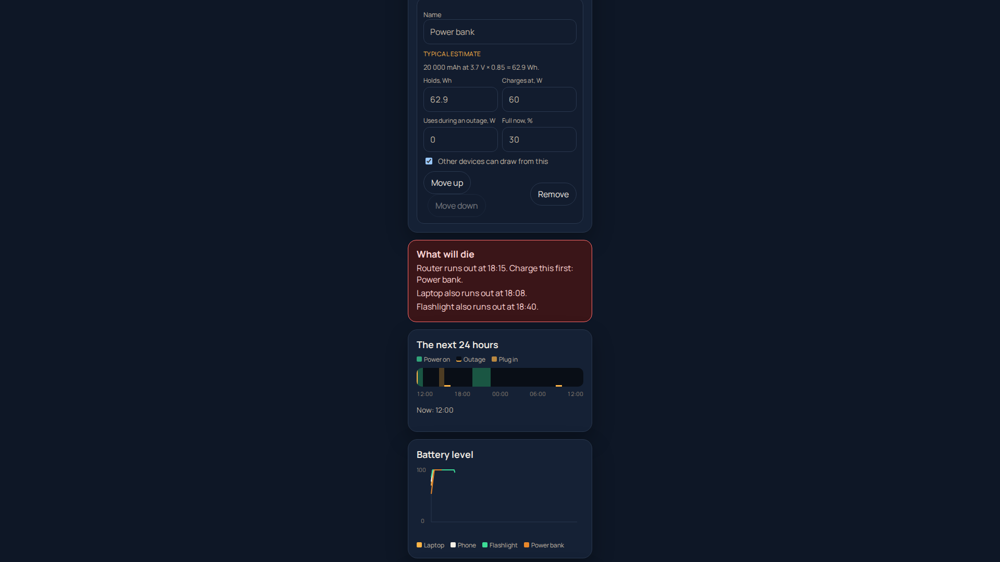

# Є заряд (Ye Zaryad)

A browser page that reads outage hours, looks at the devices you own, and says what will run out of charge and what to charge by when.



The interface is English or Ukrainian (button in the header, or `?lang=uk`; a phone set to Ukrainian opens in Ukrainian). There is no account and no server. After the first load the page opens offline. Preset wattages are typical estimates, not measurements of a real device. Schedules are typed or tapped. Nothing is fetched from a power company.

MIT License. Copyright (c) 2026 Vadym Bilobrovets.

## Plan

Built with the [Devpost Learn Skill Pack](https://github.com/challengepost/learn-ai-basics) for Build With AI: Basics.

- [Scope](devpost/scope.md)
- [Product requirements](devpost/prd.md)
- [Technical spec](devpost/spec.md)
- [Build checklist](devpost/checklist.md)

`devpost/learner-profile.md` is personal learning context and is gitignored.

## How it works

1. **Parser** (`src/domain/parseSchedule.ts`). Pasted text becomes outage ranges. It accepts `08:00–12:00`, `8-12`, `з 16:00 до 20:00`, a hyphen, an en dash, an em dash, and `24:00`. A range that crosses midnight is split. Overlaps merge. A line that cannot be read is marked and the other lines still count. Tapping an hour on the 24-hour bar edits the same ranges.
2. **Simulation** (`src/domain/simulate.ts`). The next 24 hours are walked in 15-minute steps from the current local time. On grid power, batteries charge. During an outage, a device uses its own battery first, then a power bank or charging station, higher in the list first. The result is the time a device can no longer be fully powered.
3. **Plan.** A red warning names what runs out and what to charge first. A charge list uses the form "Charge power bank by 15:15". That list downloads as a `.ics` calendar file with a reminder on each event (`src/domain/ics.ts`).

Times on screen are local. Times inside the calendar file are UTC.

## Run locally

Node.js 22.

```bash
npm install
npm run dev
```

Open the URL Vite prints. A phone-width column is centered on the dark background.

`?now=12:00` fixes the clock. That hook is for tests and the demo recording.

## Tests

```bash
npm run lint
npm test
npm run test:e2e
npm run build
```

`npm test` is Vitest, 35 tests (parser, watt-hour conversion, simulation, calendar file, and a check that every English line has a Ukrainian one). `npm run test:e2e` is four Playwright Chromium tests: sample schedule, typical kit, a "runs out" warning, an `.ics` download and reload; an offline reload; switching to Ukrainian and back; and the "power is off now" case, where the page says nothing can charge until the power is back.

## Pages

GitHub Actions (`.github/workflows/deploy.yml`) runs lint, unit tests, the browser test, and the production build on pull requests and on `main`. A push to `main` also publishes `dist/` to GitHub Pages with Vite base `/ye-zaryad/`.

Live site: https://solar-depin-hub.github.io/ye-zaryad/

## Languages

All copy is in `src/strings.ts`: one English and one Ukrainian dictionary with the same keys. Ukrainian lines put the device name after a colon ("Заряди до 15:15: Павербанк"), so no noun has to change its case. The calendar reminders use the page language. Added on 23 October 2026, after the first submission. Vadym listed "Ukrainian language" under What's next.

## Assumptions

Device sizes, charge speeds, and the exact colours are typical choices written down in `devpost/prd.md` under "Assumptions (to confirm with Vadym)". They are editable in the page. The sample schedule is labelled SAMPLE and is not a utility's text.

## Disclosure

No application code was carried over from another project. The repository started as an MIT license file. Dependencies are listed in `package.json`. The Devpost Learn Skill Pack is installed under `.agents/skills`, `agent/skills`, and `.claude/skills` and is recorded in `skills-lock.json`.

## Demo

`scripts/record-demo.mjs` records a silent 1920×1080 walkthrough with the page centered. Captions are a separate draft, not burned in. Vadym uploads the video himself.
